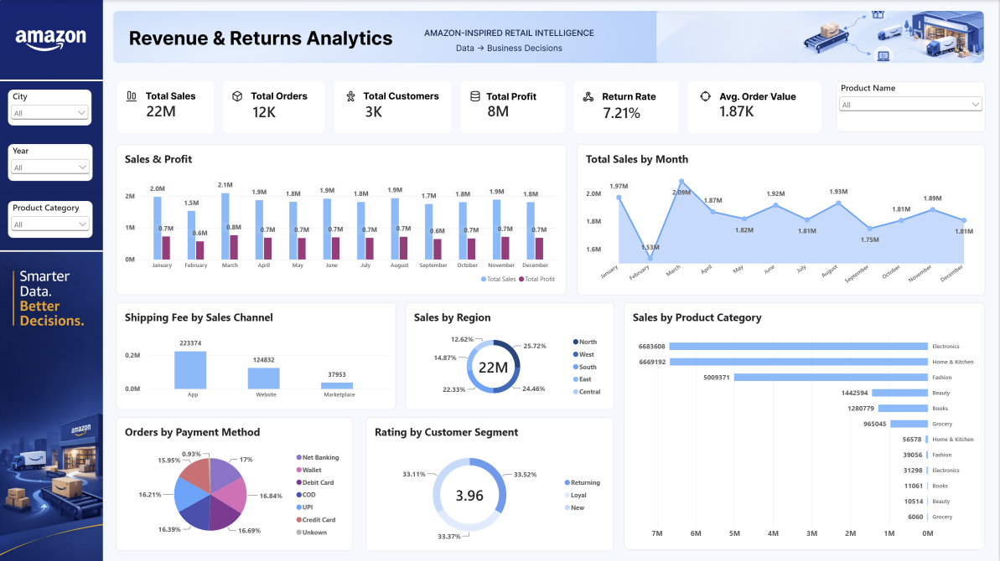

# Amazon-Inspired Revenue & Returns Analytics

**Excel Power Query | Figma | Power BI | PostgreSQL**

## 1. Project Overview

This project focuses on analyzing e-commerce sales, profitability, customer behavior, product returns, and delivery performance.

The main objective is to transform messy transactional data into a clean dataset, build an interactive Power BI dashboard, and answer business questions using SQL.

**Dataset:** Amazon-inspired synthetic e-commerce data created for learning and portfolio practice. This is not official Amazon data.

### Project Workflow

**Raw CSV → Excel Power Query → Figma → Power BI → PostgreSQL → Business Insights**

## 2. Tools Used

| Tool | Purpose |
|---|---|
| Excel Power Query | Data cleaning and transformation |
| Figma | Dashboard layout and design components |
| Power BI | Interactive dashboard and DAX measures |
| PostgreSQL | Business questions and SQL analysis |

## 3. Dataset Overview

| Details | Original Data | Cleaned Data |
|---|---|---|
| Total Rows | 11,878 | 11,878 |
| Total Columns | 22 | 27 |
| Period | 2024–2025 | 2024–2025 |
| Format | CSV | Excel |

The original dataset contained missing values, incorrect prices, inconsistent text, mixed date formats, and other data-quality issues.

---

# 4. Data Cleaning Using Excel Power Query

I used Excel Power Query to clean and transform the dataset before importing it into Power BI.

The following sections document the cleaning process and the Power Query M formulas associated with it.

*Note: Some transformations were completed using Power Query menu options. The formulas below show equivalent M logic, not necessarily the exact automatically generated Applied Steps.*

## 4.1 Order Date Cleaning

**Problem:** The `Order_Date` column contained mixed date formats.

Examples:
- `2024-02-21 15:46`
- `07/28/2024 13:30`

**Solution:**
- Identified ISO and US date formats.
- Converted them into a consistent date format.
- Removed time from the date value.
- Created `New_order_date`.

**Power Query Formula:**

```powerquery
let
    RawDate = Text.Trim(Text.From([Order_Date])),
    ParsedDate =
        if Text.Contains(RawDate, "/") then
            DateTime.FromText(
                RawDate,
                [Format="MM/dd/yyyy HH:mm", Culture="en-US"]
            )
        else
            DateTime.FromText(
                RawDate,
                [Format="yyyy-MM-dd HH:mm", Culture="en-US"]
            )
in
    Date.From(ParsedDate)
```

**Result:** Consistent dates ready for monthly and yearly sales analysis.

## 4.2 Customer ID Cleaning

**Problem:** 170 records contained missing Customer IDs.

**Solution:**
- Identified blank and null values.
- Replaced missing IDs with `Unknown`.
- Preserved the order records.

**Power Query Formula:**

```powerquery
if [Customer_ID] = null
   or Text.Trim(Text.From([Customer_ID])) = ""
then "Unknown"
else Text.Trim(Text.From([Customer_ID]))
```

**Result:** Orders with missing customer information were retained.

**Important:** `Unknown` must be excluded when calculating unique customers.

## 4.3 Customer Rating Cleaning

**Problem:** 135 customer ratings were missing.

**Solution:**
- Calculated the average available rating.
- Replaced missing ratings with 3.96.

**Power Query Formula:**

```powerquery
if [Customer_Rating] = null
then 3.96
else [Customer_Rating]
```

**Result:** Missing ratings were handled for dashboard analysis.

**Limitation:** Average-value replacement can affect rating distributions and comparisons.

## 4.4 Product Name Cleaning

**Problem:** Product names contained inconsistent capitalization and formatting.

**Solution:**
- Removed unnecessary spaces.
- Standardized capitalization.
- Corrected inconsistent product-name variations.
- Standardized the product names into 20 products.

**Power Query Formula:**

```powerquery
Text.Proper(
    Text.Trim(
        Text.Clean([Product_Name])
    )
)
```

**Result:** Consistent product names for product-level analysis.

*Product-specific abbreviations and naming differences were also corrected using Replace Values.*

## 4.5 Region Cleaning

**Problem:** Region names contained extra spaces and inconsistent formatting.

**Solution:**
- Used Find and Replace.
- Checked for additional spaces.
- Applied Trim and Clean.
- Standardized region names.

**Formula Used to Detect Extra Spaces:**

```powerquery
Text.Length([Region])
-
Text.Length(Text.Trim([Region]))
```

**Formula Used for Standardization:**

```powerquery
Text.Proper(
    Text.Trim(
        Text.Clean([Region])
    )
)
```

**Result:** Five standardized regions: North, South, East, West, and Central.

## 4.6 Sales Channel Cleaning

**Problem:** Sales-channel values had inconsistent capitalization and spaces.

**Solution:**
- Removed unnecessary spaces.
- Standardized capitalization.
- Corrected inconsistent channel names.

**Power Query Formula:**

```powerquery
Text.Proper(
    Text.Trim(
        Text.Clean([Sales_Channel])
    )
)
```

**Result:** Standardized channels: App, Website, and Marketplace.

## 4.7 Unit Price Cleaning

**Problem:** The `Unit_Price` column contained invalid prices.

| Issue | Records |
|---|---:|
| Negative unit prices | 14 |
| Zero unit prices | 11 |
| Total invalid prices | 25 |

**Solution:**
1. Created a reference-price lookup using valid positive prices.
2. Kept `Product_ID` and `Unit_Price`.
3. Removed duplicate product-price combinations.
4. Used Merge Queries to match prices by `Product_ID`.
5. Selected a Left Outer Join.
6. Expanded the matching price into `Reference_Price`.
7. Created `Unit_Price_Clean`.

**Formula Used to Identify Valid Prices:**

```powerquery
[Unit_Price] > 0
```

**Formula Used to Correct Unit Prices:**

```powerquery
let
    OriginalPrice =
        try Number.From([Unit_Price])
        otherwise null,

    LookupPrice =
        try Number.From([Reference_Price])
        otherwise null
in
    if OriginalPrice = null
       or OriginalPrice <= 0
    then LookupPrice
    else OriginalPrice
```

**Result:** 25 invalid prices were corrected using valid prices from matching products.

This was one of the most important cleaning tasks because incorrect selling prices directly affect revenue and profitability calculations.

## 4.8 Quantity Cleaning

**Problem:** The `Quantity` column contained invalid negative values.

**Solution:**
- Identified negative quantities.
- Corrected invalid quantity entries.
- Checked quantities before calculating sales.

**Power Query Formula for Validation:**

```powerquery
if [Quantity] = null then
    "Missing Quantity"
else if [Quantity] <= 0 then
    "Check Quantity"
else
    "Valid"
```

**Result:** Negative quantity issues were addressed.

*Zero-quantity records still require final validation before financial analysis.*

## 4.9 Discount Cleaning

**Problem:** Some discount percentages contained invalid values.

**Solution:**
- Identified discount percentages outside the expected range.
- Corrected invalid values.
- Used the cleaned discount column for sales calculations.

**Power Query Formula for Validation:**

```powerquery
if [Discount_Pct] = null then
    "Missing Discount"
else if [Discount_Pct] < 0
     or [Discount_Pct] > 100 then
    "Invalid Discount"
else
    "Valid"
```

**Result:** Discount values were standardized for sales calculations.

## 4.10 Payment Method Cleaning

**Problem:** 110 payment-method values were missing.

**Solution:**
- Identified missing payment methods.
- Replaced missing values with an unknown-value label.
- Standardized text formatting.

**Power Query Formula:**

```powerquery
if [Payment_Method] = null
   or Text.Trim(Text.From([Payment_Method])) = ""
then "Unknown"
else
    Text.Proper(
        Text.Trim(Text.From([Payment_Method]))
    )
```

**Result:** Payment-method records were retained for analysis.

## 4.11 Return Flag Cleaning

**Problem:** Return values had inconsistent formatting.

**Solution:**
- Removed extra spaces.
- Standardized capitalization.
- Standardized return values into Yes and No.

**Power Query Formula:**

```powerquery
Text.Proper(
    Text.Trim(
        Text.Clean([Return_Flag])
    )
)
```

**Result:** Consistent return flags for calculating returned orders and return rates.

## 4.12 Actual Delivery Date Cleaning

**Problem:** 95 records contained missing actual delivery dates.

**Solution:**
- Converted valid dates into the Date data type.
- Kept missing dates as null.
- Created `Delivery_Date_Status` to identify missing delivery information.

**Power Query Formula:**

```powerquery
if [Actual_Delivery_Date] = null
then "Missing Delivery Date"
else "Valid"
```

**Result:** Missing delivery dates were identified without inventing values.

## 4.13 Delivery Performance Classification

**Objective:** Identify whether orders were delivered on time or late.

**Power Query Formula:**

```powerquery
if [Actual_Delivery_Date] = null
   or [Promised_Delivery_Date] = null
then "Unknown"
else if [Actual_Delivery_Date]
        <= [Promised_Delivery_Date]
then "On Time"
else "Late"
```

**Result:** Deliveries were classified into:

- On Time
- Late
- Unknown

This column can help analyze the relationship between delivery delays and product returns.

---

# 5. New Columns Created

The cleaned dataset contains five additional columns compared with the original dataset.

| New Column | Purpose |
|---|---|
| `New_order_date` | Standardized order date |
| `Reference_Price` | Product price obtained through lookup |
| `Unit_Price_Clean` | Corrected selling price |
| `Delivery_Date_Status` | Identifies missing delivery dates |
| `Promised_Delivery_Date.1` | Delivery performance classification |
| `Net_Sales` | Sales after discounts |

*The original `Order_Date` was replaced by `New_order_date`, which is why six new column names result in a net increase of five columns.*

## 5.1 Net Sales Calculation

**Business Logic:**

Net Sales = Quantity × Unit Price × (1 − Discount % / 100)

**Power Query Formula:**

```powerquery
if [Quantity] = null
   or [Unit_Price_Clean] = null
   or [Discount_Pct] = null
then null
else
    [Quantity]
    * [Unit_Price_Clean]
    * (1 - [Discount_Pct] / 100)
```

**Result:** A calculated sales column that considers product quantity, corrected unit price, and discount percentage.

*Net Sales does not automatically deduct refunds or returns.*

---

# 6. Dashboard Design Using Figma

Before building the dashboard in Power BI, I designed its layout and visual components in Figma.

### Components Designed

- Amazon-inspired sidebar and branding
- Blue gradient navigation header
- Warehouse and delivery illustrations
- KPI card backgrounds and icons
- Consistent blue-and-white dashboard theme

**Design Goal:** Create a clean, professional dashboard that is easy to understand.

---

# 7. Power BI Dashboard

## Dashboard Title

**Revenue & Returns Analytics**

The dashboard focuses on business performance, customer activity, profitability, and product returns.

## 7.1 Main KPIs

| KPI | Business Purpose |
|---|---|
| Total Sales | Measure overall sales performance |
| Total Orders | Track unique orders |
| Total Customers | Measure identified customer base |
| Total Profit | Analyze product-level gross profit |
| Return Rate | Monitor product returns |
| Average Order Value | Understand average spending per order |

## 7.2 DAX Measures

The following formulas are provided for the dashboard. They should be verified against the final Power BI model.

Replace `Orders` with the actual table name in Power BI.

### 1. Total Sales

```dax
Total Sales =
SUM(Orders[Net_Sales])
```

### 2. Total Orders

```dax
Total Orders =
DISTINCTCOUNT(Orders[Order_ID])
```

### 3. Total Customers

```dax
Total Customers =
CALCULATE(
    DISTINCTCOUNT(Orders[Customer_ID]),
    Orders[Customer_ID] <> "Unknown",
    NOT ISBLANK(Orders[Customer_ID])
)
```

### 4. Total Cost

```dax
Total Cost =
SUMX(
    Orders,
    Orders[Quantity]
        * Orders[Cost_Price]
)
```

### 5. Total Profit

```dax
Total Profit =
[Total Sales] - [Total Cost]
```

This measure represents product-level gross profit after discounts, before refunds, shipping expenses, and operating costs.

### 6. Returned Orders

```dax
Returned Orders =
CALCULATE(
    DISTINCTCOUNT(Orders[Order_ID]),
    Orders[Return_Flag] = "Yes"
)
```

### 7. Return Rate

```dax
Return Rate =
DIVIDE(
    [Returned Orders],
    [Total Orders],
    0
)
```

**Format:** Percentage

### 8. Average Order Value

```dax
Average Order Value =
DIVIDE(
    [Total Sales],
    [Total Orders],
    0
)
```

**Format:** Percentage

### Dashboard Screenshot

<p align="center">
  
</p>

---

# 8. PostgreSQL Business Analysis — In Progress

After completing the Power BI dashboard, the next step is to practice SQL using the cleaned dataset.

## 8.1 Business Questions

1. Which product categories generate the highest sales and profit?
2. Which products have high sales but low profit margins?
3. Which regions have high sales and high return rates?
4. Does late delivery affect product returns?
5. Which return reasons represent the highest sales value?
6. Which sales channel generates the highest average order value?
7. Which customer segments generate the most revenue?
8. How do sales and profit change each month?
9. Which are the top three profitable products in each category?
10. Which categories need improvement based on profitability, returns, and delivery performance?

## 8.2 SQL Queries and Findings

### Question 1: Highest Sales and Profit by Category

```sql
-- Add SQL query here
```

**Finding:** To be added.

### Question 2: High-Sales, Low-Margin Products

```sql
-- Add SQL query here
```

**Finding:** To be added.

### Questions 3–10

**SQL queries, query results, business findings, and recommendations will be added after completing the analysis.**

---

# 9. Key Learnings

Through this project, I practiced:

- Cleaning messy e-commerce data using Excel Power Query
- Handling missing values and incorrect entries
- Standardizing date and text formats
- Using conditional logic and custom columns
- Creating lookup tables and merging queries
- Calculating sales after discounts
- Designing dashboard components in Figma
- Building business KPIs using DAX in Power BI
- Preparing SQL analysis based on business questions

---

# 10. Project Status

- [x] Raw dataset preparation
- [x] Data cleaning and transformation
- [x] Product-price lookup and correction
- [x] New calculated columns
- [x] Dashboard layout and component design in Figma
- [x] Final data-quality validation
- [x] Power BI dashboard completion and KPI verification
- [ ] PostgreSQL business analysis
- [ ] Final business insights and recommendations

---

# 11. Conclusion

This project helped me understand how messy e-commerce data can be transformed into meaningful business information.

I practiced data cleaning, transformation, dashboard design, and analytical thinking using tools commonly used by Data Analysts.

My goal is to build practical projects that demonstrate not only technical skills but also the ability to understand and solve business problems.

**Smarter Data. Better Decisions.**

*Disclaimer: This is an independent, Amazon-inspired portfolio project using synthetic data and is not affiliated with Amazon.*
